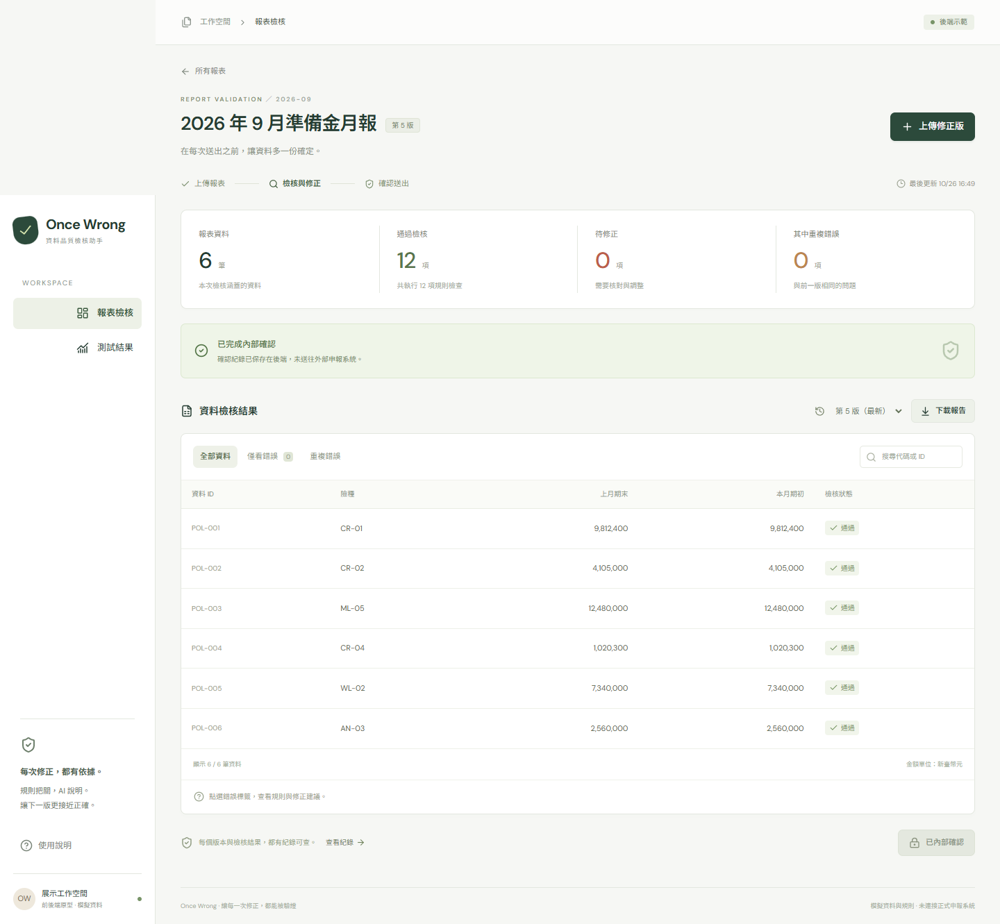
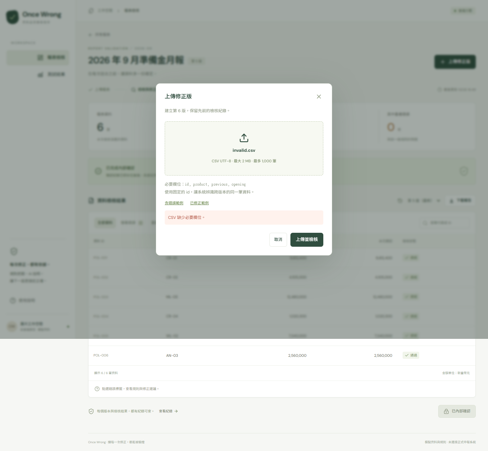
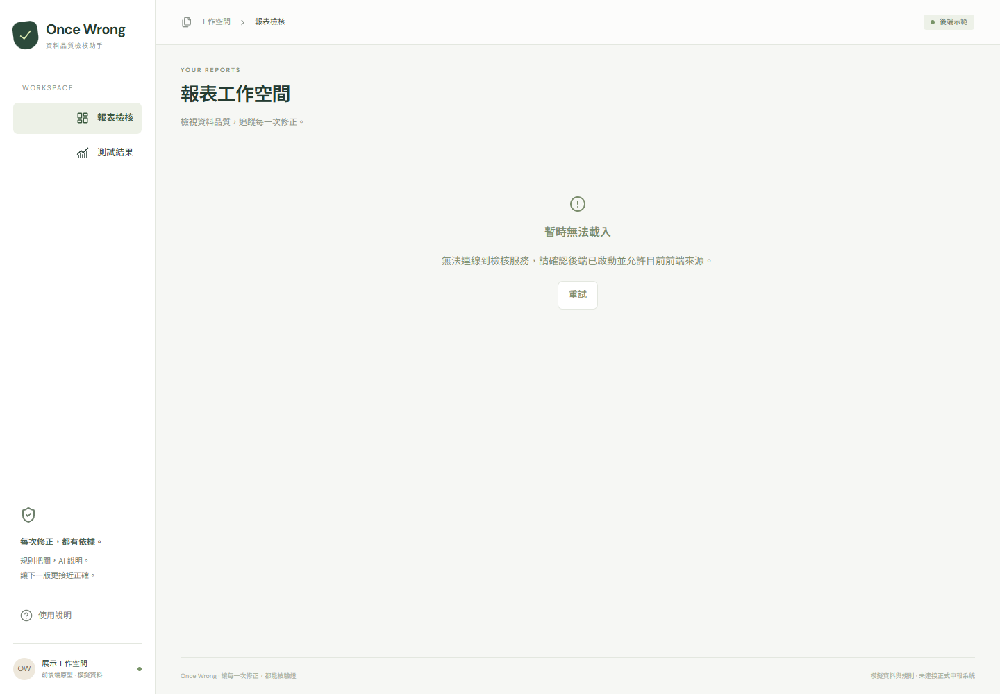

# 後端第一版驗收紀錄

日期：2026-10-26。範圍為`demo_csv_v1`、兩條團隊示範規則、持久化版本與內部確認；不包含官方保險規則、真實AI或外部申報。

## 驗收環境

- 後端：Windows，Python 3.12.14；FastAPI 0.162.0、Pydantic 2.14.1、SQLite。
- API測試：pytest 9.1.1、httpx 0.28.1；每例隔離資料庫。
- 前端：PR #1的固定commit `8e2e787d8e892aa1c263f7b0f9a36d91bd6a4a8f`，另建暫存副本，套用本PR的HTTP adapter及小範圍patch。
- 前端建置：鎖定的package-lock，`npm ci --ignore-scripts`及`npm run build`，TypeScript與Vite建置成功。
- 瀏覽器：Playwright驅動本機Chrome headless，1440px寬；實際連線127.0.0.1:5173及127.0.0.1:8000。

暫存整合不修改、推送或合併前端PR分支。本PR內保存的是後端、交接adapter及patch，重現方式見 [整合說明](../backend/integration/README.md)。

## 已執行結果

| 項目 | 結果 |
| --- | --- |
| `python -m pytest -q` | 40 passed；含非法輸入、四個client並發、重啟、確認重驗與歷史 |
| `python -m ruff check once_wrong tests` | 通過 |
| `python -m pip check` | 無依賴衝突 |
| 前端TypeScript / Vite建置 | 通過 |
| 瀏覽器端未捕捉的pageerror | 0 |
| Git diff whitespace check | 通過 |

pytest另有一項第三方Starlette TestClient/httpx棄用警告，未影響案例結果。Windows執行環境的沙箱限制asyncio本機socketpair，測試在允許本機socket的執行環境完成；沒有為通過測試而更改app事件迴圈。

## API驗收範圍

- 初始v1/v2與前端合成資料一致，回傳完整Version及後端summary。
- 錯誤CSV建立新版本，修正CSV通過兩條示範規則；舊版內容不變。
- UTF-8 BOM、CSV引號、原始bytes與SHA-256保留。
- 空檔、缺欄、重複欄名／ID、非法UTF-8／引號、負數、小數、指數／十六進位、不安全整數、超筆數與超檔案大小會拒絕，不新增成功版本。
- 未知report/version/issue回404；偽造issues/canSubmit不能取得確認。
- 同時上傳產生不同連續版本號。
- 內部確認重跑後端規則；舊版或有錯版本被拒絕，同版重試冪等。
- 新版本清除當前確認指標，但既有確認歷史及舊原檔保留；同DB重啟不重設seed。

## 實際瀏覽器流程

1. 開啟報表列表與seed v2，從UI上傳含錯CSV，後端回201與兩項問題。
2. 查看POL-003 / R-07固定說明。API回`verification=unavailable`且沒有value，畫面未出現重驗通過標章。
3. 再上傳相同錯誤檔，重複篩選顯示兩筆問題。
4. 上傳修正檔建立v5；後端回6筆資料、12次評估通過、0失敗。
5. 透過確認dialog呼叫POST，回204；畫面顯示已內部確認，按鈕停用，後端`canSubmit=false`。
6. 下載JSON並核對version ID、來源SHA-256、validation run、profile/rule version、summary及內部確認flag。
7. 切換歷史錯誤版並重新整理，保留選定版本、問題與完整歷程，舊版不可確認。
8. 實際停止並重啟後端行程，使用同一SQLite；五版資料及確認狀態完全保留。
9. 從UI上傳缺欄CSV，回422並顯示訊息，dialog保持可修正狀態，版本與確認內容不變。
10. 關閉後端後重新載入；畫面顯示服務連線錯誤。即使瀏覽器localStorage放有示範資料，也沒有切回mock。

檢查過程發現確認後`canSubmit`仍可能為true的不一致，已修正為未確認的最新通過版本才可確認，並補回歸斷言。

## 驗收畫面

確認後的版本，所有數值均為合成展示資料：

缺欄上傳顯示後端錯誤且不建立版本：

後端離線時明確報錯，不使用localStorage假資料：

## 重現

1. 依 [後端 README](../backend/README.md)安裝並跑API測試。
2. 依 [整合交接](../backend/integration/README.md)準備固定前端副本與隔離展示DB。
3. 跑`backend/integration/smoke.mjs`；每次會追加三個合成版本，不刪除資料。
4. 依整合說明的手動步驟，補驗後端重啟、非法上傳與離線畫面。

這些是本次demo流程的實測結果，不是AI準確率、正式規則覆蓋率或真實申報正確率。
