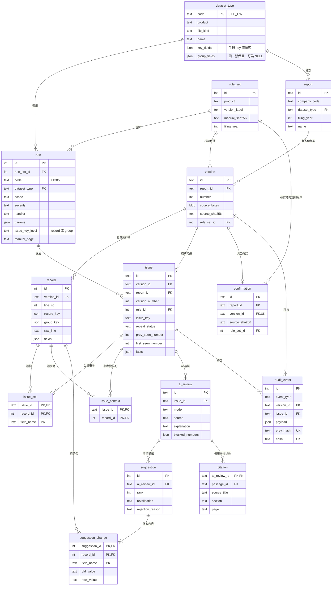

# Database Schema Design: Once Wrong（Cardif InsurHack 6-2）

**Service:** Once Wrong 申報資料檢核 | **Team:** once-wrong
**Author:** falltwo | **Reviewed by:** AI 端（#4）、前端（#1）已回覆；後端待回覆
**Date:** 2026-10-29（第 2 版） | **Database engine:** SQLite 3.44+（STRICT tables，WAL）
**Status:** Draft

相關檔案（同資料夾）：
- `schema.sql`：完整建表語法
- `verify_schema.py`：驗證腳本（`python -X utf8 verify_schema.py`），目前 42 項全部通過

---

## 白話版（先看這段）

這份設計回答一件事：**資料要怎麼存，才能做到「同一個錯不准出現第二次」，而且每一步都查得到、改不掉。**

1. **每次上傳都是一個新版本，舊版本永遠留著、不能改。** 這樣才能比對「這個錯以前有沒有出現過」。
2. **每一筆資料都記下它的「身分證」，也就是手冊規定的主鍵欄位。** 三種檔案的主鍵不一樣：承保檔是公司代號、保單編號、保單編號序號、加保日期、異動序號；給付檔是給付類別、公司代號、保單編號、保單編號序號；填報對象檔連保單都沒有，是公司代號、填報年度、險別、保險商品編號、公司保單險種代號。
3. **判斷是不是同一個錯，看的是「同一條規則、同一筆資料（或同一張保單）、同一個欄位」，不看第幾列。** 檔案順序打亂也認得出來。如果規則檢查的欄位本身就是主鍵（例如檢查異動序號、加保日期），就改用「同一張保單」來認，不然改了值但還是錯，會被當成新的錯。
4. **錯誤分三種：** 第一次出現、上一版就錯了（連續錯）、改好又壞掉（回歸錯誤）。改好又壞掉的錯，也查得到是在哪一版修好的。這個判定由資料庫自己核對，程式算錯會直接被擋下。
5. **規則是一張表**，每條規則都記下手冊檢核代碼和頁碼。要加規則就加一筆資料，不用到處改程式。
6. **AI 的每個修法建議都記下「規則重驗有沒有過」。** 只有通過的才給人看，沒通過的也留著給稽核。
7. **確認送出由資料庫把關：** 必須是最新版、零錯誤、檔案雜湊值對得上，否則資料庫直接拒絕。
8. **稽核紀錄一筆接一筆串成雜湊鏈**，只能新增，改了任何一筆，後面全部對不上。

---

## 1. Overview

申報資料檢核系統：承辦人上傳官方格式的申報檔（例如個人壽險承保檔），系統依填報手冊的檢核規則找錯、判斷是否重複出錯、讓 AI 用白話解釋並提出修法（修法要先通過規則重驗），最後由人確認送出。設計原則是**歷史不可修改、規則有出處、判定在資料庫層也能被驗證**。

**In scope：**
- 申報（report）、版本（version）、資料列（record）
- 檔案種類與主鍵定義（dataset_type）、規則版本（rule_set）與檢核規則（rule）
- 檢核結果（issue、issue_cell、issue_context）與重複錯誤判定
- AI 審核（ai_review、suggestion、suggestion_change、citation）
- 確認（confirmation）與稽核事件（audit_event）

**Out of scope：**
- 帳號與權限：原型用 `uploaded_by`／`confirmed_by` 文字欄位記錄操作者，沒有登入系統。
- 手冊知識庫段落：維持 AI 端的 JSONL 檔，以手冊 SHA-256 綁定版本；資料庫只存引用的段落編號和出處快照（citation）。
- 統計報表（覆證報表、死亡率計算）：手冊第伍章的統計計算不在 6-2 題目範圍內。
- 跨檔勾稽的儲存方式：等後端決定（見 Open Questions 第 1 題）。

### Assumptions（設計前提）

| 前提 | 來源 |
|---|---|
| 承保資料 key 值順序：公司代號、保單編號、保單編號序號、加保日期、異動序號 | 人壽保險業個人壽險填報手冊 2025，p.5 |
| 給付資料 key 值順序：給付類別、公司代號、保單編號、保單編號序號（沒有異動序號） | 同上，p.31 |
| 填報對象資料 key 值順序：公司代號、填報年度、險別、保險商品編號、公司保單險種代號（沒有保單號碼） | 同上，p.37 |
| 多筆檢核指同一保單號碼（保單編號＋保單編號序號）的資料 | 新式個人壽險填報手冊範例&檢核規則_2025，伍-31 註 |
| 承保與給付的勾稽用保單號碼，加上「給付檔事故日期＝承保檔退保日期」 | 同上，伍-31 LD 規則、LD10 註 |
| 保發中心檢核有誤會退回，公司須在 15 個工作日內回覆修正檔，所以同一份申報會有多個版本 | 個人壽險填報手冊 2025，p.2 |
| 規則程式用手冊中文欄名讀資料（`加保別`、`退保日期`…） | #4 回覆 |
| 欄位中有證件號碼、出生日期等個資；原型只用模擬資料 | 手冊欄位定義 |
| 單一公司、單一機器執行；每份申報數千到數萬筆，版本數十個以內 | 推測，待組員確認 |

---

## 2. Entity Relationship Diagram



**Relationship summary：**

| Entity A | Relationship | Entity B | Notes |
|---|---|---|---|
| dataset_type | has many | report、rule | 主鍵欄位由檔案種類定義 |
| report | has many | version | 版號連續，由觸發器保證 |
| version | has many | record | 版本與資料列上傳後不可修改 |
| version | has many | issue | `issue` 帶 `report_id`，用複合外鍵 `(version_id, report_id)` 保證一致 |
| issue | many-to-many（via issue_cell） | record | 出錯的格子，修法只能改這些 |
| issue | many-to-many（via issue_context） | record | 整筆給 AI 參考的資料列，不能改 |
| rule_set | has many | rule | 一本手冊版本一組規則；版本記錄所用的規則版本 |
| issue | has many | ai_review | 可重跑，取最新一次 |
| ai_review | has many | suggestion | 每個修法候選都記重驗結果 |
| version | has zero or one | confirmation | 只有最新且零錯誤的版本可以確認 |

---

## 3. Table Definitions

完整 DDL 在 `schema.sql`，這裡只寫每張表的用途和需要說明的欄位。

### `dataset_type`：申報檔案種類

| Column | Notes |
|---|---|
| code | 例如 `LIFE_UW`（承保）、`LIFE_CLAIM`（給付）、`LIFE_SUBJECT`（填報對象） |
| key_fields | 手冊「key 值順序」的欄名陣列。三種檔案各不相同，見 Assumptions |
| group_fields | 「同一張保單」的欄名陣列（公司代號、保單編號、保單編號序號）。填報對象檔沒有保單，為 NULL |

### `rule_set`：規則版本
一本填報手冊的一個版本。`manual_sha256` 記錄手冊檔案的雜湊值，確保「依據哪一版手冊」查得到、換不掉。

### `rule`：檢核規則（規則表）

| Column | Notes |
|---|---|
| code | 手冊檢核代碼，例如 `L1305`；`UNIQUE (rule_set_id, code)` |
| scope | `single_record`／`multi_record`／`cross_file`／`cross_period` |
| severity | `error` 會擋確認；`warning` 只提醒 |
| handler | 程式裡的實作名稱。#4 的 11 條規則都是 dataclass，可以用 `rule_id=code` 建出來 |
| params | 同一個實作服務多條規則時的參數，例如 `ValidDate`：L1402 是 `{"column":"加保日期"}`、L1602 是 `{"column":"退保日期"}` |
| issue_key_level | `record`：用整筆主鍵認「同一個錯」；`group`：用保單認。**規則檢查的欄位是主鍵的一部分時必須用 `group`**（例如 L0302 檢查異動序號、L1402 檢查加保日期）。觸發器擋下「`group` 規則用在沒有保單的檔案」 |
| manual_page | 出處，例如 `伍-17` |

### `report`：一份申報
`UNIQUE (company_code, dataset_type, filing_year)`。`id` 沿用 PR #2 的文字 ID，API 不用改格式。

### `version`：一次上傳
保存原始檔（`source_bytes`）與 SHA-256。`UNIQUE (report_id, number)`；觸發器保證版號 = 目前最大版號 + 1。

### `record`：資料列

| Column | Notes |
|---|---|
| fields | 全部欄位（JSON），key 用手冊中文欄名，值一律是原始文字（保留前置 0 與空白） |
| record_key | 依 `key_fields` 從 `fields` 取值組成的 JSON 陣列，例如 `["01","A00002","0001","20250301","00001"]` |
| group_key | 依 `group_fields` 取值組成的 JSON 陣列；填報對象檔為 NULL |
| raw_line | 原始定長文字，追查與重現用 |

觸發器 `trg_record_keys` 檢查：主鍵欄位都在 `fields` 裡，且 `record_key`、`group_key` 跟 `fields` 一致。程式寫入時用精簡 JSON（`separators=(",", ":")`），資料庫用 `json()` 正規化後比對。

主鍵**刻意不設 UNIQUE**：錯誤資料可能出現重複主鍵，那正是規則要抓的錯（Q10）。

### `issue`：檢核結果

| Column | Notes |
|---|---|
| issue_key | `sha256(JSON [規則代碼, 層級, 排序去重後的 [定位鍵, 欄位] 清單])`。定位鍵在 `record` 層級是 `record_key`，在 `group` 層級是 `group_key`。**不用列號** |
| repeat_status | `new`／`repeated`（上一版也有）／`regressed`（曾出現、上一版修好、這版又出現） |
| prev_seen_number | 這個錯上一次出現的版號；`new` 時為 NULL。`regressed` 的「修好的版本」就是 `prev_seen_number + 1`，前端可以直接顯示 |
| first_seen_number | 這個錯第一次出現的版號 |
| report_id, version_number | 從 version 複製過來，服務 Q3 歷史查詢；複合外鍵與觸發器保證一致 |
| facts | 程式算好的數字（expected、actual、diff），AI 只能引用這裡的數字 |

`repeat_status` 由 `CHECK` 從 `prev_seen_number` 推出，觸發器再檢查 `prev_seen_number`、`first_seen_number` 跟歷史一致。

### `issue_cell`：出錯的格子
`PRIMARY KEY (issue_id, record_id, field_name)`。修法只能改這些格子。

### `issue_context`：參考資料列
`PRIMARY KEY (issue_id, record_id)`。整筆給 AI 參考、不能改，對應 #4 的 `Violation.context_rows`（例如 L1305 要看同一保單的前一筆）。

兩張表都由觸發器保證資料列與錯誤屬於同一個版本。

### `ai_review`、`suggestion`、`suggestion_change`、`citation`：AI 審核
- `ai_review.source` 對應 #4 的 `ExplanationSource`（`ai`／`fallback_llm_error`／`fallback_number_guard`），三個值相同。
- `suggestion.revalidation`：`passed`／`failed`（同一條規則仍未通過，或產生新的錯）／`invalid_target`（格子不存在、改到出錯格子以外、同一格兩個值、沒有實際修改、值的格式不合法）。`CHECK` 保證通過的建議沒有拒絕原因、沒通過的一定有原因。每個候選都存一筆，對應 `rank`。
- `citation.passage_id` 存知識庫的 `Passage.id`（例如 `LIFE-RULE-0068`），**不是** prompt 裡臨時的 `K1`、`K2`。知識庫重建後編號可能改變，所以同時存 `source_title`、`section`、`page` 快照，前端的 `Citation` 型別也直接用這幾欄。

### `confirmation`：人工確認
`UNIQUE (version_id)`。觸發器檢查三件事：最新版本、沒有 `error` 等級的錯、雜湊值與規則版本跟版本一致。

### `audit_event`：稽核事件
只能新增。`prev_hash UNIQUE` 保證鏈不會分岔；`hash = sha256(prev_hash ‖ 正規化 JSON)` 由程式計算。驗證時從第一筆（`prev_hash` 為 64 個 0）依序重算即可。#4 的事件（`rule_check`、`ai_review`、`ai_error`）由後端 adapter 轉成 `validation_completed`、`ai_review_completed`，並帶上 `issue_id`。

---

## 4. Index Strategy

| Table | Index | Columns | Query served |
|---|---|---|---|
| version | `UNIQUE (report_id, number)` | report_id, number | Q1 版本清單 |
| issue | `idx_issue_version_rule` | version_id, rule_id | Q2 某版本的檢核結果 |
| issue | `idx_issue_history` | report_id, issue_key, version_number | Q3 重複錯誤判定（覆蓋索引） |
| issue_cell | 主鍵 | issue_id, record_id, field_name | Q4 出錯格子 |
| record | `idx_record_group` | version_id, group_key | Q5 同一保單的所有資料列（多筆規則） |
| rule | `idx_rule_set_dataset` | rule_set_id, dataset_type | Q6 載入某版本的規則 |
| ai_review | `idx_ai_review_issue` | issue_id, created_at | Q7 最新的 AI 審核 |
| audit_event | `idx_audit_version` | version_id, id | Q8 某版本的稽核事件 |
| confirmation | `idx_confirmation_report` | report_id, confirmed_at | Q9 最新確認 |
| record | `idx_record_key` | version_id, record_key | Q10 某版本重複的主鍵（覆蓋索引） |
| issue_context | 主鍵 | issue_id, record_id | Q11 參考資料列 |
| issue_cell、issue_context、suggestion_change | `idx_*_record` | record_id | 反查某筆資料牽涉哪些錯；外鍵索引 |
| 其餘 | 外鍵索引 | rule.dataset_type、report.dataset_type、version.rule_set_id、issue.rule_id、audit_event.issue_id | 外鍵檢查與反查 |

---

## 5. Access Pattern Analysis

`verify_schema.py` 對每個查詢跑了 `EXPLAIN QUERY PLAN`，全部走索引，沒有全表掃描。

| # | 查詢 | 查詢計畫（實測） |
|---|---|---|
| Q1 | 某申報的版本清單 | `SEARCH version USING INDEX sqlite_autoindex_version_2 (report_id=?)` |
| Q2 | 某版本的檢核結果，依規則篩 | `SEARCH issue USING INDEX idx_issue_version_rule` |
| Q3 | 判斷重複錯誤：同申報、同 issue_key、較早版本的最大與最小版號 | `SEARCH issue USING COVERING INDEX idx_issue_history` |
| Q4 | 一個錯的出錯格子 | `SEARCH issue_cell USING PRIMARY KEY` |
| Q5 | 同一保單在某版本的所有資料列 | `SEARCH record USING INDEX idx_record_group` |
| Q6 | 某規則版本、某檔案種類的規則 | `SEARCH rule USING INDEX idx_rule_set_dataset` |
| Q7 | 某個錯最新的 AI 審核 | `SEARCH ai_review USING INDEX idx_ai_review_issue` |
| Q8 | 某版本的稽核事件 | `SEARCH audit_event USING INDEX idx_audit_version` |
| Q9 | 某申報最新的確認 | `SEARCH confirmation USING INDEX idx_confirmation_report` |
| Q10 | 某版本重複的主鍵 | `SEARCH record USING COVERING INDEX idx_record_key` |
| Q11 | 一個錯的參考資料列 | `SEARCH issue_context USING PRIMARY KEY` |

Q3 的寫法（寫入新的檢核結果前，用它算 `prev_seen_number` 與 `first_seen_number`）：

```sql
SELECT max(version_number) AS prev_seen_number,
       min(version_number) AS first_seen_number
FROM issue
WHERE report_id = :report_id
  AND issue_key = :issue_key
  AND version_number < :current_number;
```

---

## 6. Normalization Decisions

| Decision | Approach | Reasoning |
|---|---|---|
| 申報欄位要不要全部拆成欄位？ | **全部放 `fields` JSON，主鍵另外組成 `record_key`／`group_key`** | 三種檔案欄位完全不同（承保 58 欄、給付 30 欄、填報對象 10 欄），拆欄位會變成每種檔案一張表。規則與重複判定只靠主鍵查詢；其他欄位由規則程式讀整筆處理。哪天某欄位需要 SQL 篩選，再拆出來加索引 |
| 主鍵欄位放哪裡？ | **由 `dataset_type.key_fields` 定義，`record_key` 存組好的值** | 第 1 版把承保檔的主鍵寫死成 4 個欄位，給付檔、填報對象檔放不進去，而且漏了加保日期。改成資料定義後，加新的檔案種類不用改表 |
| `record_key` 是從 `fields` 算出來的，算不算重複存？ | **刻意反正規化，由觸發器檢查一致** | 服務 Q5、Q10 的索引查詢；資料列不可修改，不會過期 |
| `issue` 複製 `report_id`、`version_number` | **刻意反正規化** | 服務 Q3（每次寫入檢核結果都要查歷史）。用複合外鍵和觸發器保證跟 version 一致 |
| `repeat_status`、`prev_seen_number` 存起來 | **存，並由 CHECK 和觸發器驗證** | 畫面每次顯示都要用；歷史不可修改，值不會過期 |
| 同一個錯用什麼定位？ | **每條規則選 `record` 或 `group` 層級** | 規則檢查的欄位是主鍵的一部分時，值一改主鍵就變，用整筆主鍵會把同一個錯當成新錯 |
| 參考資料列要不要跟出錯格子放同一張表？ | **分開成 `issue_context`** | 參考的是整筆，沒有欄位名稱；分開後 `issue_cell` 的每一列都是可以改的格子，語意單純 |
| 規則邏輯放資料表還是程式？ | **登記在表、邏輯在程式（handler＋params）** | 多筆、跨檔規則（例如 L1305）無法用單純條件描述 |
| 手冊段落放資料庫？ | **不放，只存段落編號和出處快照** | 段落是唯讀參考資料；快照讓知識庫重建後舊的引用仍然看得懂 |
| AI 修法的修改內容 | **獨立 `suggestion_change` 表** | 一個修法可能改多筆、多欄；要能反查「某筆資料被建議改過什麼」 |

---

## 7. Triggers and Automation

全部在 `schema.sql` 第 6 節。SQLite 沒有 `TIMESTAMPTZ`，時間一律由程式寫入 UTC ISO 8601 文字（結尾 `Z`），並用 `CHECK` 檢查格式。`trg_record_keys` 用到聚合函數內的 `ORDER BY`，所以需要 SQLite 3.44 以上。

| 觸發器 | 作用 |
|---|---|
| `trg_*_no_update`／`trg_*_no_delete` | 版本、資料列、檢核結果、AI 審核、建議、確認、稽核事件都不能改；稽核事件也不能刪 |
| `trg_version_number_sequence` | 版號必須連續 |
| `trg_record_keys` | 主鍵欄位不能缺；`record_key`、`group_key` 必須跟 `fields` 一致 |
| `trg_rule_group_level` | `group` 層級的規則只能用在有保單的檔案種類 |
| `trg_issue_consistency` | 檢核結果的版號與規則版本必須跟所屬版本一致 |
| `trg_issue_repeat_status` | `prev_seen_number`、`first_seen_number` 必須跟歷史一致 |
| `trg_issue_cell_same_version`、`trg_issue_context_same_version` | 出錯格子、參考資料列必須屬於同一個版本 |
| `trg_confirmation_rules` | 只能確認最新版、零 error、雜湊值與規則版本要一致 |

---

## 8. Migration Notes（從 PR #2 的資料表搬過來）

PR #2 目前有 `reports`、`versions`（整份版本存成 `payload_json`）、`confirmations` 三張表，只有示範資料。

| Step | Description | 向下相容 | Risk |
|---|---|---|---|
| 1 | 建立新資料表（這份 schema），寫入三種檔案的 `dataset_type` | 是，新增 | 低 |
| 2 | 改寫 `storage.py`：上傳時寫 `version` → 依 `dataset_type` 解析成 `record` → 跑規則寫 `issue`／`issue_cell`／`issue_context` → 寫 `audit_event` | 否，API 回傳格式要對齊 | 中 |
| 3 | API 提供 `repeat_status`、`prev_seen_number`、`first_seen_number`，前端分開顯示三種狀態（#1 回覆） | 否 | 低 |
| 4 | 規則改由 `rule` 表＋handler 載入；把 #4 的 `rules/life.py` 搬進後端，並為每條規則設定 `issue_key_level` | 否 | 中 |
| 5 | 示範資料（R-01／R-07 的 4 欄 CSV）不搬，重新用官方格式的模擬資料建立 | — | 低 |
| 6 | 刪除舊的 `reports`、`versions`、`confirmations` | 否，破壞性 | 低（只有示範資料） |

**Rollback：** 步驟 1 可直接刪新表。步驟 2–4 是程式變更，用 git 還原。步驟 6 會刪資料，執行前先備份 SQLite 檔。

---

## Verification

`python -X utf8 verify_schema.py`（SQLite 3.50.4，記憶體資料庫）：**42 項全部通過**，包含：

- **異動序號規則（#4 舉的例子）**：L0302 在 v1 是 `00001、00003、00003`，v2 改成 `00001、00002、00004` 還是錯。用整筆主鍵算會變成兩個不同的錯；改用保單層級後 v2 正確判成 `repeated`。
- **加保日期規則**：L1402 在 v3 壞成跟 v1 不同的值，整筆主鍵跟著變；用保單層級仍正確判成 `regressed`，並查得到在 v2 修好。v3 刻意打亂資料順序。
- **三種檔案都存得進去**：給付檔（沒有異動序號）、填報對象檔（沒有保單號碼、沒有 `group_key`）。
- 主鍵欄位缺少、`record_key` 或 `group_key` 跟 `fields` 對不上，都會被擋；`group` 層級規則用在填報對象檔會被擋。
- 判定寫錯（把 regressed 寫成 new 或 repeated、`prev_seen_number` 或 `first_seen_number` 寫錯）會被擋。
- 確認：有錯、舊版本、雜湊值不符都會被擋；零錯誤的最新版可以確認。
- 不可修改：版本、資料列、檢核結果、稽核事件改或刪都會被擋。
- 出錯格子、參考資料列跨版本都會被擋。
- 稽核鏈：從頭重算全部對得上；同一個 `prev_hash` 用兩次（分岔）會被擋。
- Q1～Q11 查詢計畫全部走索引；`PRAGMA foreign_key_check` 無結果。

---

## Quality Checks

- [x] 每張表都有主鍵；有時間意義的表都有建立時間欄位。
- [x] 每個外鍵都有索引（由主鍵、UNIQUE 或專用索引提供）。
- [x] 時間統一為 UTC ISO 8601 並以 `CHECK` 檢查（SQLite 沒有 `TIMESTAMPTZ`）。
- [x] 沒有軟刪除；歷史改用「不可修改」保證。
- [x] 每個查詢都有對應索引，且經 `EXPLAIN QUERY PLAN` 實測。
- [x] JSON 欄位都有說明為什麼不拆成欄位，並以 `json_valid` 檢查格式。
- [x] 正規化與反正規化的決定都寫了理由。
- [x] 有從 PR #2 搬遷的步驟與回復方式。

---

## Open Questions

1. **跨檔勾稽（等後端回覆）**：承保對給付的 LD 規則會牽涉兩個檔案的資料。#4 建議同一次申報的承保檔和給付檔一起上傳、算成同一個版本，這樣不用放寬「錯誤只能牽涉同一版本的資料」。採用的話要改：`report` 改成以險種（而不是檔案種類）為單位、`version` 的原始檔拆成 `version_file` 子表、`record` 記錄屬於哪個檔案。
2. **資料量（等後端／資料回覆）**：每份申報筆數、版本數，目前是推測。
3. **個資**：除了 `record.fields`，AI 的稽核事件也存完整 prompt，裡面有送給 Gemini 的資料列（出錯列加參考列）。正式環境要不要遮罩或加密，兩處都要一起決定。
4. **欄名不一致**：填報手冊的填報對象檔欄名（`險別`、`保險商品編號`）跟檢核規則手冊（`填報險別`、`公司保單商品編碼`）不同。這份設計用填報手冊的名稱，規則程式要用同一套。
5. **每條規則的 `issue_key_level`**：目前只確認了 L0302、L1402 要用 `group`。把 #4 的 11 條規則搬進後端時，要逐條檢查「檢查的欄位是不是主鍵」。

## 修訂紀錄

- **第 2 版（2026-10-29）**：依 #4、#1 在 PR #5 的回覆修改。主鍵改由檔案種類定義（第 1 版寫死承保檔 4 個欄位，給付檔、填報對象檔放不進去，也漏了加保日期）；新增保單層級的 `issue_key`；參考資料列分到 `issue_context`；新增 `prev_seen_number`；`citation` 改存 `Passage.id` 並加出處快照。驗證從 28 項增加到 42 項。
- **第 1 版（2026-10-28）**：初版。

## Later, if needed
- 多公司共用：`report.company_code` 已在，若要多租戶再加存取控制。
- 大量資料：常篩選的欄位從 `fields` 拆出來加索引。
- 稽核鏈定期把最新 `hash` 寫到外部（例如 Git commit），防止整條鏈被一起重寫。
