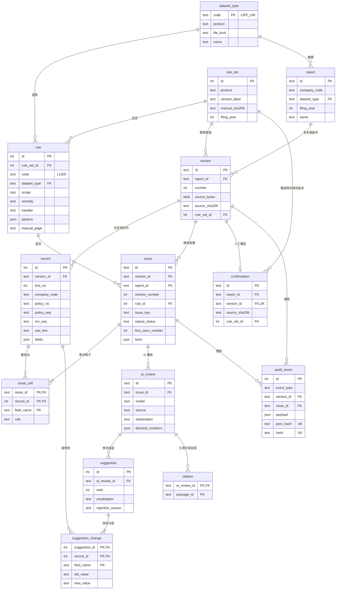

# Database Schema Design: Once Wrong（Cardif InsurHack 6-2）

**Service:** Once Wrong 申報資料檢核 | **Team:** once-wrong
**Author:** falltwo | **Reviewed by:** 待後端組員審查
**Date:** 2026-10-28 | **Database engine:** SQLite 3.50（STRICT tables，WAL）
**Status:** Draft

相關檔案（同資料夾）：
- `schema.sql`：完整建表語法
- `verify_schema.py`：驗證腳本（`python -X utf8 verify_schema.py`），目前 28 項全部通過

---

## 白話版（先看這段）

這份設計回答一件事：**資料要怎麼存，才能做到「同一個錯不准出現第二次」，而且每一步都查得到、改不掉。**

1. **每次上傳都是一個新版本，舊版本永遠留著、不能改。** 這樣才能比對「這個錯以前有沒有出現過」。
2. **每一筆保單資料都記下它的「身分證」**，也就是公司代號、保單編號、保單編號序號、異動序號這四欄（手冊稱為主要 KEY 值）。判斷是不是同一個錯時，看的是「同一條規則、同一張保單、同一個欄位」，**不看第幾列**。就算組員把檔案順序打亂，系統也認得出是同一個錯。
3. **錯誤分三種：** 第一次出現、上一版就錯了（連續錯）、改好又壞掉（回歸錯誤）。這個判定由資料庫自己核對，程式算錯會直接被擋下。
4. **規則是一張表**，每條規則都記下手冊檢核代碼和頁碼。要加規則就加一筆資料，不用到處改程式。
5. **AI 的每個修法建議都記下「規則重驗有沒有過」。** 只有通過的才給人看，沒通過的也留著給稽核。
6. **確認送出由資料庫把關：** 必須是最新版、零錯誤、檔案雜湊值對得上，否則資料庫直接拒絕。
7. **稽核紀錄一筆接一筆串成雜湊鏈**，只能新增，改了任何一筆，後面全部對不上。

---

## 1. Overview

申報資料檢核系統：承辦人上傳官方格式的申報檔（例如個人壽險承保檔，每筆 58 個欄位），系統依填報手冊的檢核規則找錯、判斷是否重複出錯、讓 AI 用白話解釋並提出修法（修法要先通過規則重驗），最後由人確認送出。設計原則是**歷史不可修改、規則有出處、判定在資料庫層也能被驗證**。

**In scope：**
- 申報（report）、版本（version）、資料列（record）
- 規則版本（rule_set）與檢核規則（rule）
- 檢核結果（issue、issue_cell）與重複錯誤判定
- AI 審核（ai_review、suggestion、suggestion_change、citation）
- 確認（confirmation）與稽核事件（audit_event）

**Out of scope：**
- 帳號與權限：原型用 `uploaded_by`／`confirmed_by` 文字欄位記錄操作者，沒有登入系統。
- 手冊知識庫段落：維持 AI 端現有的 JSONL 檔（`kb/passages.jsonl`），以手冊 SHA-256 綁定版本；資料庫只記段落編號（citation）。
- 統計報表（覆證報表、死亡率計算）：手冊第伍章的統計計算不在 6-2 題目範圍內。

### Assumptions（設計前提）

| 前提 | 來源 |
|---|---|
| 官方承保資料每筆 58 欄，主要 KEY 值為公司代號 9(02)＋保單編號 X(15)＋保單編號序號 X(05)＋異動序號 9(05) | 新式個人壽險填報手冊範例&檢核規則_2025，壹-1 |
| 一個險種有多種檔案（承保、給付、填報對象），有跨檔勾稽 | 人壽保險業個人壽險填報手冊_2025，目錄；PR #3 規則索引 |
| 保發中心檢核有誤會退回，公司須在 15 個工作日內回覆修正檔，所以同一份申報會有多個版本 | 個人壽險填報手冊_2025，第 2 頁「資料管制」 |
| 規則同時有單筆、多筆（同保單前後異動）、跨檔、跨期 | `feat/ai-review` 的 `rules/life.py`（L1305 等）；PR #3 `rule_inventory.json` |
| 一個錯可能牽涉多筆資料、多個欄位 | `feat/ai-review` 的 `Violation.cells` 與 `context_rows` |
| 原型只用模擬資料，但欄位中有證件號碼、出生日期、郵遞區號等個資 | 手冊欄位 4、8、45、46 |
| 單一公司、單一機器執行；每份申報數千到數萬筆，版本數十個以內 | 推測，待組員確認 |

---

## 2. Entity Relationship Diagram



**Relationship summary：**

| Entity A | Relationship | Entity B | Notes |
|---|---|---|---|
| report | has many | version | 版號連續，由觸發器保證 |
| version | has many | record | 版本與資料列上傳後不可修改 |
| version | has many | issue | `issue` 帶 `report_id`，用複合外鍵 `(version_id, report_id)` 保證一致 |
| issue | many-to-many（via issue_cell） | record | 一個錯可牽涉多筆資料；`role` 區分「出錯格子」與「僅供參考」 |
| rule_set | has many | rule | 一本手冊版本一組規則；版本記錄所用的規則版本 |
| issue | has many | ai_review | 可重跑，取最新一次 |
| ai_review | has many | suggestion | 每個修法都記重驗結果 |
| version | has zero or one | confirmation | 只有最新且零錯誤的版本可以確認 |

---

## 3. Table Definitions

完整 DDL 在 `schema.sql`，這裡只寫每張表的用途和需要說明的欄位。

### `dataset_type`：申報檔案種類
`code` 例如 `LIFE_UW`（個人壽險承保）、`LIFE_CLAIM`（個人壽險給付）。`UNIQUE (product, file_kind)`。

### `rule_set`：規則版本
一本填報手冊的一個版本。`manual_sha256` 記錄手冊檔案的雜湊值（例如 `3003e7cf…`），確保「依據哪一版手冊」查得到、換不掉。

### `rule`：檢核規則（規則表）

| Column | Notes |
|---|---|
| code | 手冊檢核代碼，例如 `L1305`；`UNIQUE (rule_set_id, code)` |
| scope | `single_record`／`multi_record`／`cross_file`／`cross_period`，前端可用來說明錯誤類型 |
| severity | `error` 會擋確認；`warning` 只提醒 |
| handler | 程式裡的實作名稱。複雜規則（例如 L1305 要串同保單前後異動）無法只靠資料描述，所以邏輯在程式、登記在表 |
| params | 同一個實作服務多條規則時的參數，例如 `ValidDate` 用 `{"column":"加保日期"}` 服務 L1402 |
| manual_page | 出處；AI 說明與畫面都能引用 |

### `report`：一份申報
`UNIQUE (company_code, dataset_type, filing_year)`。`id` 沿用 PR #2 的文字 ID，API 不用改格式。

### `version`：一次上傳
保存原始檔（`source_bytes`）與 SHA-256。`UNIQUE (report_id, number)`；觸發器保證版號 = 目前最大版號 + 1。

### `record`：資料列

| Column | Notes |
|---|---|
| company_code, policy_no, policy_seq, txn_seq | 手冊的主要 KEY 值，拆成欄位，因為規則與重複錯誤都靠它定位 |
| raw_line | 原始定長文字，追查與重現用 |
| fields | 其餘欄位（JSON）。只有被查詢的欄位才拆成欄位 |

主要 KEY 值**刻意不設 UNIQUE**：錯誤資料可能出現重複主鍵，那正是規則要抓的錯。

### `issue`：檢核結果

| Column | Notes |
|---|---|
| issue_key | `sha256(規則代碼 + 排序後的 [(主要 KEY 值, 欄位)])`。**不用列號**，資料順序改變仍能比對 |
| repeat_status | `new`／`repeated`（上一版也有）／`regressed`（曾出現、上一版修好、這版又出現） |
| first_seen_number | 這個錯第一次出現的版號 |
| report_id, version_number | 從 version 複製過來，服務 Q3 歷史查詢；複合外鍵與觸發器保證一致 |
| facts | 程式算好的數字（expected、actual、diff），AI 只能引用這裡的數字 |

### `issue_cell`：錯誤牽涉的格子
`PRIMARY KEY (issue_id, record_id, field_name)`。`role = error`：修法只能改這些；`role = context`：只給 AI 參考（對應 AI 端的 `context_rows`）。觸發器保證格子與錯誤屬於同一個版本。

### `ai_review`、`suggestion`、`suggestion_change`、`citation`：AI 審核
- `ai_review.source` 對應 AI 端的 `ExplanationSource`（`ai`／`fallback_llm_error`／`fallback_number_guard`）。
- `suggestion.revalidation`：`passed`／`failed`／`invalid_target`（改了不能改的格子）。`CHECK` 保證通過的建議沒有拒絕原因、沒通過的一定有原因。
- `citation.passage_id` 對應知識庫段落編號（例如 `K3`）。

### `confirmation`：人工確認
`UNIQUE (version_id)`。觸發器檢查三件事：最新版本、沒有 `error` 等級的錯、雜湊值與規則版本跟版本一致。

### `audit_event`：稽核事件
只能新增。`prev_hash UNIQUE` 保證鏈不會分岔；`hash = sha256(prev_hash ‖ 正規化 JSON)` 由程式計算。驗證時從第一筆（`prev_hash` 為 64 個 0）依序重算即可。

---

## 4. Index Strategy

| Table | Index | Columns | Query served |
|---|---|---|---|
| version | `UNIQUE (report_id, number)` | report_id, number | Q1 版本清單 |
| issue | `idx_issue_version_rule` | version_id, rule_id | Q2 某版本的檢核結果 |
| issue | `idx_issue_history` | report_id, issue_key, version_number | Q3 重複錯誤判定（覆蓋索引） |
| issue_cell | 主鍵 | issue_id, record_id, field_name | Q4 錯誤牽涉的格子 |
| issue_cell | `idx_issue_cell_record` | record_id | 反查某筆資料有哪些錯；外鍵索引 |
| record | `idx_record_policy` | version_id, company_code, policy_no, policy_seq, txn_seq | Q5 同保單的所有異動（多筆規則） |
| rule | `idx_rule_set_dataset` | rule_set_id, dataset_type | Q6 載入某版本的規則 |
| ai_review | `idx_ai_review_issue` | issue_id, created_at | Q7 最新的 AI 審核 |
| audit_event | `idx_audit_version` | version_id, id | Q8 某版本的稽核事件 |
| confirmation | `idx_confirmation_report` | report_id, confirmed_at | Q9 最新確認 |
| 其餘 | 外鍵索引 | rule.dataset_type、report.dataset_type、version.rule_set_id、issue.rule_id、suggestion_change.record_id、audit_event.issue_id | 外鍵檢查與反查 |

---

## 5. Access Pattern Analysis

`verify_schema.py` 對每個查詢跑了 `EXPLAIN QUERY PLAN`，全部走索引，沒有全表掃描。

| # | 查詢 | 查詢計畫（實測） |
|---|---|---|
| Q1 | 某申報的版本清單 | `SEARCH version USING INDEX sqlite_autoindex_version_2 (report_id=?)` |
| Q2 | 某版本的檢核結果，依規則篩 | `SEARCH issue USING INDEX idx_issue_version_rule` |
| Q3 | 判斷重複錯誤：同申報、同 issue_key、較早版本 | `SEARCH issue USING COVERING INDEX idx_issue_history` |
| Q4 | 一個錯牽涉的格子 | `SEARCH issue_cell USING PRIMARY KEY` |
| Q5 | 同一保單在某版本的所有異動（依異動序號） | `SEARCH record USING INDEX idx_record_policy` |
| Q6 | 某規則版本、某檔案種類的規則 | `SEARCH rule USING INDEX idx_rule_set_dataset` |
| Q7 | 某個錯最新的 AI 審核 | `SEARCH ai_review USING INDEX idx_ai_review_issue` |
| Q8 | 某版本的稽核事件 | `SEARCH audit_event USING INDEX idx_audit_version` |
| Q9 | 某申報最新的確認 | `SEARCH confirmation USING INDEX idx_confirmation_report` |

Q3 的寫法：

```sql
SELECT version_number
FROM issue
WHERE report_id = :report_id
  AND issue_key = :issue_key
  AND version_number < :current_number;
```

---

## 6. Normalization Decisions

| Decision | Approach | Reasoning |
|---|---|---|
| 58 個申報欄位要不要全部拆成欄位？ | **主要 KEY 值拆出，其餘放 `fields` JSON** | 規則與重複判定只靠主要 KEY 值查詢；其他欄位由規則程式讀整筆資料處理，不在 SQL 裡篩選。不同險種欄位完全不同，拆欄位會變成每種檔案一張表。哪天某欄位需要 SQL 篩選，再拆出來加索引 |
| `issue` 複製 `report_id`、`version_number` | **刻意反正規化** | 服務 Q3（每次寫入檢核結果都要查歷史）。用複合外鍵 `(version_id, report_id)` 和觸發器保證不會跟 version 不一致；歷史不可修改，所以不會過期 |
| `repeat_status` 存起來，不在查詢時算 | **存，並由觸發器驗證** | 畫面每次顯示都要用；歷史不可修改，值不會過期；觸發器確保程式算錯會被擋下 |
| 規則邏輯放資料表還是程式？ | **登記在表、邏輯在程式（handler＋params）** | 多筆、跨檔規則（例如 L1305）無法用單純條件描述；表格負責出處、版本、嚴重度、參數，讓前端、AI、稽核都讀同一份 |
| 手冊段落放資料庫？ | **不放，維持知識庫 JSONL** | 段落是唯讀的參考資料，以手冊 SHA-256 綁定版本；資料庫只記引用的段落編號 |
| AI 修法的修改內容 | **獨立 `suggestion_change` 表** | 一個修法可能改多筆、多欄；要能反查「某筆資料被建議改過什麼」 |

---

## 7. Triggers and Automation

全部在 `schema.sql` 第 6 節。SQLite 沒有 `TIMESTAMPTZ`，時間一律由程式寫入 UTC ISO 8601 文字（結尾 `Z`），並用 `CHECK` 檢查格式。

| 觸發器 | 作用 |
|---|---|
| `trg_*_no_update`／`trg_*_no_delete` | 版本、資料列、檢核結果、AI 審核、建議、確認、稽核事件都不能改；稽核事件也不能刪 |
| `trg_version_number_sequence` | 版號必須連續 |
| `trg_issue_consistency` | 檢核結果的版號與規則版本必須跟所屬版本一致 |
| `trg_issue_repeat_status` | `repeat_status`、`first_seen_number` 必須跟歷史一致 |
| `trg_issue_cell_same_version` | 錯誤牽涉的資料列必須屬於同一個版本 |
| `trg_confirmation_rules` | 只能確認最新版、零 error、雜湊值與規則版本要一致 |

---

## 8. Migration Notes（從 PR #2 的資料表搬過來）

PR #2 目前有 `reports`、`versions`（整份版本存成 `payload_json`）、`confirmations` 三張表，只有示範資料。

| Step | Description | 向下相容 | Risk |
|---|---|---|---|
| 1 | 建立新資料表（這份 schema） | 是，新增 | 低 |
| 2 | 改寫 `storage.py`：上傳時寫 `version` → 解析成 `record` → 跑規則寫 `issue`／`issue_cell` → 寫 `audit_event` | 否，API 回傳格式要對齊 | 中 |
| 3 | 規則改由 `rule` 表＋handler 載入；把 `feat/ai-review` 的 `rules/life.py` 搬進後端 | 否 | 中 |
| 4 | 示範資料（R-01／R-07 的 4 欄 CSV）不搬，重新用官方格式的模擬資料建立 | — | 低 |
| 5 | 刪除舊的 `reports`、`versions`、`confirmations` | 否，破壞性 | 低（只有示範資料） |

**Rollback：** 步驟 1 可直接刪新表。步驟 2、3 是程式變更，用 git 還原。步驟 5 會刪資料，執行前先備份 SQLite 檔。

---

## Verification

`python -X utf8 verify_schema.py`（SQLite 3.50.4，記憶體資料庫）：**28 項全部通過**，包含：

- 重複錯誤：L1305 連續兩版出錯判為 `repeated`；L1402 在 v2 修好、v3 又壞判為 `regressed`。v3 刻意打亂資料順序，仍判定正確。
- 判定寫錯（把 regressed 寫成 new、first_seen 寫錯）會被觸發器擋下。
- 確認：有錯、舊版本、雜湊值不符都會被擋；零錯誤的最新版可以確認。
- 不可修改：版本、資料列、檢核結果、稽核事件改或刪都會被擋。
- 稽核鏈：從頭重算全部對得上；同一個 `prev_hash` 用兩次（分岔）會被擋。
- Q1～Q9 查詢計畫全部走索引。
- `PRAGMA foreign_key_check` 無結果。

另外用 draw.io 技能的 `sqlerd.py` 讀 `schema.sql`，解析出 14 張表、21 個外鍵，與設計一致。

---

## Quality Checks

- [x] 每張表都有主鍵；有時間意義的表都有建立時間欄位（`created_at`／`uploaded_at`／`occurred_at`／`confirmed_at`）。
- [x] 每個外鍵都有索引（由主鍵、UNIQUE 或專用索引提供）。
- [x] 時間統一為 UTC ISO 8601 並以 `CHECK` 檢查（SQLite 沒有 `TIMESTAMPTZ`）。
- [x] 沒有軟刪除；歷史改用「不可修改」保證。
- [x] 每個查詢都有對應索引，且經 `EXPLAIN QUERY PLAN` 實測。
- [x] JSON 欄位都有說明為什麼不拆成欄位，並以 `json_valid` 檢查格式。
- [x] 正規化與反正規化的決定都寫了理由。
- [x] 有從 PR #2 搬遷的步驟與回復方式。

---

## Open Questions（要跟組員確認）

1. **給付檔、填報對象檔的主要 KEY 值**是否也是這四欄？這份設計只依承保檔的範例確認過。
2. **跨檔勾稽**（承保檔對給付檔）時，`issue_cell` 會牽涉兩個版本的資料。目前觸發器要求格子屬於同一個版本；跨檔規則上線前，要決定是「一次上傳多個檔案成為同一版」，還是放寬這條限制。
3. **個資欄位**（證件號碼、出生日期、郵遞區號）：原型只用模擬資料。正式環境是否要在寫入前遮罩或加密 `fields`，要另外決定。
4. **重複錯誤的額外關卡**：資料庫已經能分出 `repeated` 和 `regressed`。產品上要多做什麼，例如必須填原因、或要第二人確認，還沒決定。
5. **資料量假設**：每份申報筆數、版本數，目前是推測。

## Later, if needed
- 多公司共用：`report.company_code` 已在，若要多租戶再加存取控制。
- 大量資料：`record` 改成每個險種一張表，或把常篩選的欄位拆出來加索引。
- 稽核鏈定期把最新 `hash` 寫到外部（例如 Git commit），防止整條鏈被一起重寫。
